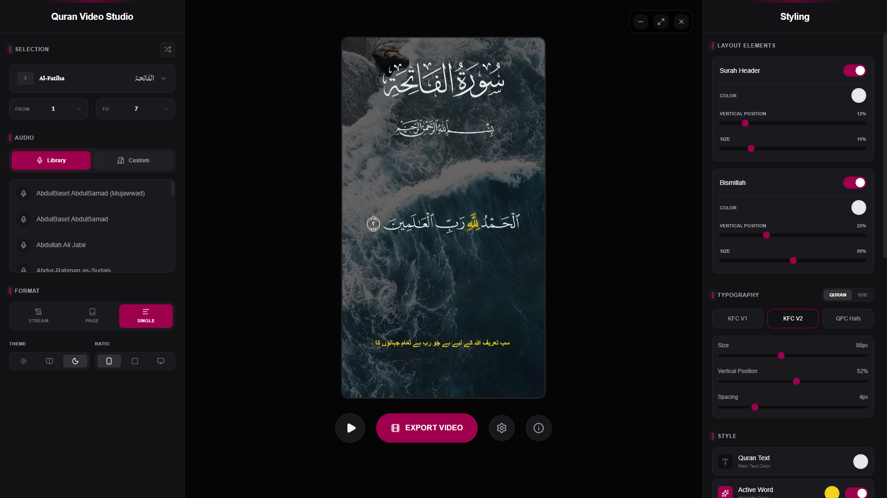

# 🎬 Quran Studio

> Quran Studio is a web and desktop-ready editor for creating Quran recitation videos. It combines Quran text, translations, timed recitation audio, typography controls, and visual backgrounds into an exportable MP4 canvas workflow.

Inspired by and built with appreciation for [Quran Video Studio](https://github.com/quran8vs/Quran-Video-Studio). Many thanks to the original project contributors.

[](https://github.com/DashingMZA/quran-studio/releases)
[](https://github.com/DashingMZA/quran-studio/releases)
[](https://github.com/DashingMZA/quran-studio/releases)

The app is built with modern web technologies (React, Vite, TypeScript, Tailwind CSS) and can run in the browser or as a Desktop app with native installers for Windows, macOS, and Linux.

[](LICENSE)
[](https://react.dev)
[](https://vitejs.dev)
[](https://www.typescriptlang.org)
[](https://tailwindcss.com)
[](https://pnpm.io)
[](https://tauri.app)

[](https://github.com/DashingMZA/)
[](https://github.com/DashingMZA/)
[](https://github.com/DashingMZA/)

<p>
  <sub>Built with love ❤︎ in Pakistan 🇵🇰 with the help of AI • <a href="https://t.me/dashingmza">Contact via Telegram</a></sub>
</p>  

[](https://buymeacoffee.com/dashingmza)
[](https://ko-fi.com/dashingmza)
[](https://dashingmza.gumroad.com/coffee)
---



## 📋 Table of Contents

- [✨ Features](#-features)
- [🛠️ Tech Stack](#️-tech-stack)
- [🚀 Quick Start](#-quick-start)
- [📜 Scripts](#-scripts)
- [⚠️ Troubleshooting](#️-troubleshooting)
- [📁 Project Structure](#-project-structure)
- [🖥️ Desktop App](#️-desktop-app-tauri)
- [🚢 Release Process](#-release-process)
- [☁️ Web Deployment](#️-web-deployment)
- [📝 License](#-license)
- [❤️ Support My Work](#-support-my-work)


---

## ✨ Features

### 📖 Content Selection

- **Surah & Verse Navigation** - Easily browse and select any Surah and verse range
- **Multiple Reciters** - Choose from renowned Quran reciters with high-quality audio

### 🎵 Audio Tools

- **Waveform Visualization** - See your audio in real-time
- **Playback Controls** - Full control over audio timing and synchronization
- **Audio Synchronization** - Perfectly aligned audio with text display

### 🎨 Video Customization

- **Typography** - Multiple Arabic and English font options
- **Color Control** - Customize text colors, backgrounds, and highlighting
- **Background Support** - Solid colors or custom uploaded images
- **Layout Options** - Toggle Surah headers, Bismillah, and translations
- **Aspect Ratios** - `9:16` (Story/TikTok), `1:1` (Instagram), `16:9` (YouTube)

### 💾 Export & Production

- **MP4 Export** - High-quality video generation
- **Client-Side Processing** - Fast processing with `mediabunny` (WebCodecs)
- **No Server Upload** - Your videos stay private

---

## 🛠️ Tech Stack

| Layer                  | Technology                        |
| ---------------------- | --------------------------------- |
| **Frontend Framework** | React 19 + TypeScript             |
| **Build Tool**         | Vite                              |
| **Package Manager**    | pnpm 12 (`packageManager` pinned) |
| **Styling**            | Tailwind CSS                      |
| **Icons**              | Lucide React                      |
| **Video Processing**   | mediabunny                        |
| **State Management**   | React Hooks                       |
| **Desktop (Optional)** | Tauri 2.0                         |

---

## Requirements

- [Node.js 24+](https://nodejs.org/) (see `engines` in `package.json`)
- [pnpm 12.9.1](https://pnpm.io/) — installed automatically via `packageManager` + Corepack
- A [Pixabay API key](https://pixabay.com/api/docs/) (for the Image/Video background tabs)
- A browser with WebCodecs support for MP4 export

## Environment

Copy `.env.example` to `.env` and fill in your values:

```env
VITE_PIXABAY_API_KEY=your_pixabay_api_key_here
```

The key is used by the Image and Video background tabs to fetch results from Pixabay. The web version works without it, but the background tabs will show no results.

## 🚀 Quick Start

Install dependencies:

```bash
pnpm install
```

Start the development server:

```bash
pnpm dev
```

Vite is configured to run on port `3000` by default:

```text
http://localhost:3000
```

Production build:

```bash
pnpm build
```

## 📜 Scripts

```bash
pnpm dev          # Start the Vite development server
pnpm build        # Type-check (tsc) and build the production app
pnpm preview      # Preview the production build locally
pnpm lint         # Run ESLint (zero warnings allowed)
pnpm typecheck    # Run tsc --noEmit only
pnpm test         # Run Vitest test suite
pnpm format       # Format with Prettier
```

Desktop (Tauri) scripts — these download the platform ffmpeg/ffprobe
sidecar binaries first (they are too large for git, ~130 MB each):

```bash
pnpm app:dev      # Tauri desktop app in development (hot reload)
pnpm app:build    # Build the desktop installers
pnpm fetch:ffmpeg # Only download the ffmpeg/ffprobe binaries
```

---

## ⚠️ Troubleshooting

### Issue: MIME Type Error - "Expected a JavaScript module script but the server responded with a MIME type of ''"

This error occurs when your dev server isn't properly serving `.ts` or `.js` files.

---

## Backgrounds

The Image tab is the default background mode. On initial load, the app automatically fetches Pixabay image results and applies a random image as the canvas background.

The Video tab fetches Pixabay videos on initial load as well. Until a video is selected, the editor keeps the current image background instead of falling back to a solid color. Selecting a video applies its poster as the preview and uses the MP4 stream while rendering the canvas.

## Export Notes

MP4 export is rendered from the canvas at 30 FPS with H.264 video and AAC audio. The exported file name includes the surah, ayah range, and reciter.

For best results:

- Wait for audio, fonts, and background assets to load before exporting.
- Use same-origin or CORS-enabled visual assets for canvas export.
- Keep the browser tab active while exporting long videos.

## 📁 Project Structure

```text
src/
  app/                         Main application shell
  config/                      App metadata (name, version, social links)
  features/
    audio/                     Audio playback and recording hooks
    quran/                     Quran data, surah data, and fetching hooks
    video-editor/              Canvas, export hooks, media loading, rendering
  layouts/                     Left/right sidebars and editor controls
  shared/                      Reusable components, constants, utilities
public/
  fonts/                       Local font assets
  icon/                        App icons and manifest files
  social_media/                Brand icons (lucide-react no longer ships these)
src-tauri/                     Tauri desktop shell (Rust + window config)
scripts/                       ffmpeg/ffprobe sidecar download helpers
.github/workflows/             CI release workflow (desktop installers)
```

## 🖥️ Desktop App (Tauri)

`src-tauri/` is already fully configured — **do not run `tauri init`**.

Prerequisites: a Rust toolchain (`rustup`) plus the platform webview
dependencies (see the [Tauri prerequisites](https://tauri.app/start/prerequisites/)).

```bash
# Development with hot reload
pnpm app:dev

# Build native installers (Windows/macOS/Linux)
pnpm app:build
```

The desktop build bundles `ffmpeg`/`ffprobe` as sidecars (downloaded by
`scripts/fetch-ffmpeg.mjs` from `descriptinc/ffmpeg-ffprobe-static`) and
supports auto-updates via the updater plugin (see [Release Process](#-release-process)).

## 🚢 Release Process

Desktop releases are built by GitHub Actions (`.github/workflows/release.yml`):
push a `v*` tag (e.g. `v1.0.0`) and the workflow builds Windows, macOS
(Apple Silicon + Intel) and Linux installers, then creates a **draft**
GitHub Release with all artifacts and the updater manifest (`latest.json`).

Full step-by-step guide — signing keys, GitHub Secrets, triggering a
release: see **[release.md](./release.md)**.

## ☁️ Web Deployment

The web version is a static Vite SPA — the same `dist/` build runs on
Vercel, Cloudflare Workers, or any static host. The app detects Tauri vs.
web at runtime (`src/shared/utils/platform.ts`), so the identical build
output runs everywhere.

**Important:** `VITE_PIXABAY_API_KEY` is baked into the bundle at build
time. Set it in your `.env` (local/CLI deploys) or in the hosting
dashboard's build environment (git-connected deploys) _before_ building,
otherwise the Image/Video background tabs will be empty.

### ▲ Vercel 

1. Import the repository in Vercel — the framework is auto-detected as **Vite**.
2. Build command `pnpm build`, output directory `dist` (already set in `vercel.json`).
3. Add the environment variable `VITE_PIXABAY_API_KEY` in the Vercel dashboard
   (Project Settings → Environment Variables).

[](https://vercel.com/new/clone?repository-url=https%3A%2F%2Fgithub.com%2FDashingMZA%2Fquran-studio)

### 🟠 Cloudflare Workers

The app is a pure client-side SPA (no server code, no database), so it
deploys to Workers as **static assets** — see `wrangler.toml`. No Worker
script is needed; Cloudflare serves `./dist` directly at the edge, with
`single-page-application` fallback to `index.html`.

**Dashboard, git-connected (recommended):** Workers & Pages → Create →
Connect to Git → select `DashingMZA/quran-studio`. Production branch =
**`master`**, build command = `pnpm build`, deploy command =
`npx wrangler deploy`. Add build variables `NODE_VERSION=24`,
`PNPM_VERSION=12.9.1`, and `VITE_PIXABAY_API_KEY` before the first deploy.

**CLI:** `pnpm exec wrangler login` (one-time), then `pnpm deploy:cf`.

Full step-by-step: [release.md](./release.md#4-web-deploy--cloudflare-workers-alternative-to-vercel).

[](https://deploy.workers.cloudflare.com/?url=https://github.com/DashingMZA/quran-studio)

---

## 📝 License

This project is open source under the **GNU General Public License v3.0**
— see [LICENSE](./LICENSE) for details.

---

## ☕ Support My Work

If you find my open-source projects useful, consider supporting my work. Your contributions help me maintain existing projects and build new tools.

[](https://buymeacoffee)
[](https://ko-fi.com/dashingmza)
[](https://dashingmza.gumroad.com/coffee)

---

**Happy creating! 🎬✨**
